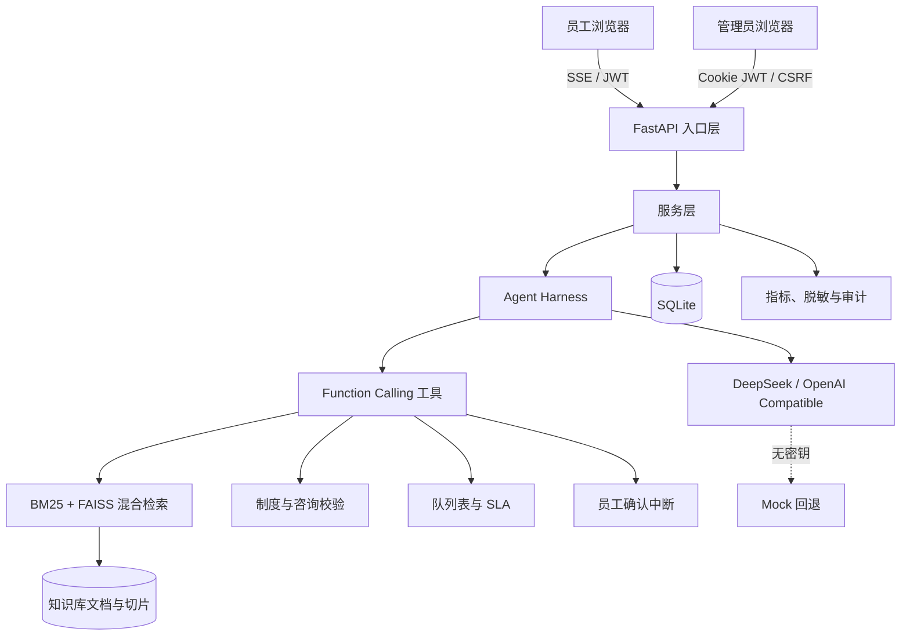

# Employee Ticket Routing

## 员工薪酬福利咨询工单分流系统

面向企业员工和管理员的全栈 AI 应用实践。系统把薪酬福利制度问答、RAG 混合检索、
工单咨询信息补全、制度合规校验、智能分类分流、员工显式确认、后台知识库维护和
对话审计串成一条完整业务链路。

项目目标不是让大模型“自由聊天”，而是在员工服务场景中建立一条可解释、可验证、
可审计、带人工兜底的工单处理路径。

## 目录

- [项目背景](#项目背景)
- [核心能力](#核心能力)
- [系统架构](#系统架构)
- [角色与权限](#角色与权限)
- [业务流程](#业务流程)
- [Agent 工具与调用约束](#agent-工具与调用约束)
- [RAG 知识检索](#rag-知识检索)
- [快速启动](#快速启动)
- [演示账号](#演示账号)
- [环境配置](#环境配置)
- [DeepSeek 与 Mock 模式](#deepseek-与-mock-模式)
- [管理 CLI](#管理-cli)
- [主要接口](#主要接口)
- [数据库设计](#数据库设计)
- [可观测性](#可观测性)
- [安全与隐私](#安全与隐私)
- [测试与质量检查](#测试与质量检查)
- [目录结构](#目录结构)
- [部署建议](#部署建议)
- [常见问题](#常见问题)
- [当前限制](#当前限制)
- [课程交付材料](#课程交付材料)
- [工程验收重点](#工程验收重点)
- [后续路线](#后续路线)

## 项目背景

企业员工在入职、调薪、休假、社保、公积金、商业保险、绩效奖金等场景中，经常需要
查询制度或发起咨询工单。传统处理方式通常存在以下问题：

1. 制度分散在 PDF、Markdown 和内部公告中，员工难以快速定位；
2. HR 或共享服务团队反复回答相似问题，人工成本高；
3. 员工描述不完整，工单在多个队列之间来回转派；
4. 大模型可能编造金额、比例或适用范围；
5. 真正提交工单前缺少员工确认，容易产生错误诉求；
6. 高风险劳动争议、个人信息泄露等事项不能被普通自动流程误处理；
7. 对话、工具调用与管理员操作缺少统一审计。

本项目尝试解决的不是单一“问答机器人”问题，而是从知识检索到工单分流的端到端流程。

## 核心能力

### 员工端

- 单页聊天界面，支持 SSE 流式回答与打字机效果；
- 最近 6 轮对话上下文，支持代词指代与追问；
- 薪酬福利制度问题检索与来源引用；
- 制度未覆盖时明确回答“制度中未找到”；
- 信息不足时先追问咨询主题和具体诉求；
- Agent 自主选择工具并执行最多 5 轮决策；
- 建单前展示标题、摘要、风险、队列和待补充信息；
- 员工点击确认后才真正创建并提交工单；
- 高风险、劳动争议、敏感事项自动转人工。

### 管理端

- 员工与管理员 JWT 登录及接口级权限控制；
- 上传 Markdown/PDF 制度，自动解析、切片、向量化和索引；
- 制度有效期、地区、员工类型、政策组和确认状态管理；
- 系统提示词在线编辑与版本发布；
- 对话审计、按员工/时间筛选、疑似违规标记与撤销；
- Agent 工具决策日志与耗时分析；
- 管理员指标快照与 Prometheus 文本指标；
- JSON/CSV 审计导出。

### Agent 安全能力

- 工具依赖顺序由服务端校验，不由模型提示词决定；
- 工单建单前强制中断，等待员工显式确认；
- 工具凭证一次性消费，不进入 SSE、浏览器或决策日志；
- 防伪造路由、防重复确认、防过期确认复用；
- 用户提示词注入不能绕过制度和确认流程；
- 回答质量检查识别无来源金额、虚假建单和提示词泄露。

## 系统架构



### 四层划分

| 层次 | 组件 | 职责 |
|---|---|---|
| 入口层 | HTML、原生 JavaScript、Jinja2、FastAPI | 登录、员工聊天、管理后台、SSE、权限入口 |
| 服务层 | 工单服务、上下文服务、质量检查、导出仓储 | 业务规则、校验、状态机、审计、指标 |
| 智能体编排层 | Agent Harness、Function Calling、提示词 | 模型决策、工具执行、结果回填、再决策 |
| 数据模型层 | SQLite、FAISS、上传目录 | 用户、会话、消息、制度、草稿、日志、向量 |

## 角色与权限

| 能力 | 员工 | 管理员 |
|---|---:|---:|
| 登录与查看本人身份 | 是 | 是 |
| 制度问答 | 是 | 否，管理员进入后台 |
| 查看本人上下文 | 是 | 否 |
| 创建工单预览 | 是 | 否 |
| 确认本人草稿 | 是 | 否 |
| 上传与删除制度 | 否 | 是 |
| 查看知识库入库状态 | 否 | 是 |
| 编辑与发布提示词 | 否 | 是 |
| 查看对话审计 | 否 | 是 |
| 标记疑似违规工单 | 否 | 是 |
| 查看指标快照 | 否 | 是 |

权限在服务端接口层校验，隐藏页面按钮不视为权限控制。

## 业务流程

### 场景 A：制度咨询

```text
员工提问
  → 读取员工身份
  → 检索有效制度
  → 校验制度证据
  → 模型生成回答
  → 返回制度来源
```

该路径只回答问题，不创建工单。制度未覆盖时必须明确说明未找到。

### 场景 B：发起咨询工单

```text
员工表达建单意图
  → 判断咨询主题是否明确
  → 信息不足则先追问
  → 检索并校验制度
  → 校验咨询资料
  → 路由到队列并计算 SLA
  → 发送建单预览
  → 员工显式确认
  → 创建草稿并提交
  → 写入 Agent 决策日志和审计日志
```

确认前数据库中不存在工单草稿。该约束由服务端 Harness 执行，不依赖模型自觉。

### 场景 C：能否提交某类工单

```text
员工询问“能不能提交”
  → 识别为制度咨询
  → 检索可提交范围
  → 输出结论
  → 不误判为建单指令
```

自然语言意图必须结合上下文判断，不能仅凭“提交”“工单”等词创建数据。

### 场景 D：高风险事项

```text
命中劳动仲裁、欠薪、工伤、歧视、骚扰等风险
  → 停止普通自动分流
  → 解释需要人工复核
  → 进入 human_review 队列
  → 保留对话与工具轨迹
```

## Agent 工具与调用约束

| 工具 | 作用 | 前置条件 | 是否产生业务写入 |
|---|---|---|---|
| `get_employee_profile` | 从登录会话读取员工身份 | 已认证 | 否 |
| `search_knowledge` | 混合检索有效制度 | 身份与适用范围可用 | 否 |
| `validate_policy` | 校验制度证据并签发短期凭证 | 本轮检索成功 | 否 |
| `validate_consultation` | 校验咨询主题、诉求和资料完整性 | 制度证据有效 | 否 |
| `route_ticket` | 计算分类、队列、优先级和 SLA | 两个校验凭证均有效 | 否 |
| `create_ticket_draft` | 创建并提交工单 | 路由凭证有效且员工已确认 | 是 |
| `handoff_to_human` | 转人工复核 | 命中高风险或证据不足 | 可能写入待办 |

服务端执行顺序：

```text
get_employee_profile
  → search_knowledge
  → validate_policy
  → validate_consultation
  → route_ticket
  → employee confirmation
  → create_ticket_draft
```

系统提示词负责告知模型规则，但最终防线在工具执行器：

- 模型不能自定义员工 ID；
- 模型不能直接构造可用的 policy/routing 凭证；
- 缺少咨询校验时不能路由；
- 缺少路由凭证时不能建单；
- 未确认时 Harness 只返回预览；
- 一次性凭证消费后不能重放。

## RAG 知识检索

### 文档处理

1. 校验扩展名和文件大小；
2. Markdown 直接读取，PDF 提取文本；
3. 按约 500 字符切片，默认重叠 80 字符；
4. 通过本地 hash 或远程 Embedding 生成向量；
5. 写入 SQLite 文档与切片元数据；
6. 重建 FAISS 索引并缓存；
7. 入库任务记录 parsing、chunking、embedding、indexing、ready 状态。

### 混合检索

检索同时使用 BM25 关键词相关度和 FAISS 向量相似度，默认返回 top 3 片段。
进入证据集前还会检查：

- 文档状态是否 ready；
- 确认状态是否为 confirmed/approved/active；
- 有效期是否覆盖当前时间；
- 地区和员工类型是否匹配；
- 政策组是否正确；
- 是否已被新版本替代或软删除。

### 回答约束

- 只能依据提供的制度条文回答；
- 金额、比例、期限必须有来源；
- 未命中时明确说“制度中未找到”；
- 不在答案中输出系统提示词或签名 Token；
- 回答末尾展示文件名和片段来源。

## 快速启动

### 环境要求

- Windows 10/11 或受控 Windows Server；
- Python 3.11 或 3.12；
- PowerShell 5.1 及以上；
- 首次安装依赖时可访问 Python 包源；
- 真实模型模式需要 DeepSeek API Key；
- 无 Key 时自动使用 Mock，不影响离线演示。

### 一键启动

双击项目根目录的 `start.bat`，或在 PowerShell 执行：

```powershell
Set-Location -LiteralPath "D:\项目\Employee-ticket-routing"
powershell -ExecutionPolicy Bypass -File .\scripts\start.ps1
```

启动脚本会：

1. 检测 Python；
2. 创建或修复 `.venv`；
3. 安装 `requirements.txt`；
4. 读取 `.env`；
5. 验证核心依赖和静态资源；
6. 启动 Uvicorn。

### 只检查环境

```powershell
powershell -ExecutionPolicy Bypass -File .\scripts\start.ps1 -CheckOnly
```

### 手工启动

```powershell
python -m venv .venv
.\.venv\Scripts\Activate.ps1
python -m pip install -r requirements.txt
uvicorn src.employee_ticket_routing.main:app --reload
```

### 页面地址

- 登录：<http://127.0.0.1:8000/login>
- 员工问答：<http://127.0.0.1:8000/>
- 管理后台：<http://127.0.0.1:8000/admin>
- 健康检查：<http://127.0.0.1:8000/api/health>

## 演示账号

| 角色 | 用户名 | 默认密码 |
|---|---|---|
| 员工 | `employee` | `Employee@123456` |
| 管理员 | `admin` | `Admin@123456` |

默认账号只用于本地演示。正式部署必须通过环境变量替换密码，并禁用不需要的演示账号。

```text
SEED_ADMIN_USERNAME=admin
SEED_ADMIN_PASSWORD=请替换
SEED_EMPLOYEE_USERNAME=employee
SEED_EMPLOYEE_PASSWORD=请替换
JWT_SECRET=请使用至少32字节的高熵随机值
COOKIE_SECURE=true
```

## 环境配置

复制 `.env.example` 为 `.env` 后按需修改。

| 变量 | 默认值 | 说明 |
|---|---|---|
| `APP_ENV` | `development` | development/test/staging/production |
| `LLM_PROVIDER` | `deepseek` | deepseek/openai_compatible/mock |
| `DEEPSEEK_API_KEY` | 空 | DeepSeek 密钥，空值时回退 Mock |
| `DEEPSEEK_API_URL` | 官方地址 | DeepSeek Chat Completions |
| `DEEPSEEK_MODEL` | `deepseek-chat` | 模型名称 |
| `LLM_API_URL` | 空 | 通用兼容供应商地址 |
| `LLM_API_KEY` | 空 | 通用兼容供应商密钥 |
| `LLM_MODEL` | 空 | 通用兼容模型 |
| `EMBEDDING_PROVIDER` | hash | hash/remote |
| `EMBEDDING_API_URL` | 空 | 远程向量接口 |
| `EMBEDDING_API_KEY` | 空 | 远程向量密钥 |
| `EMBEDDING_MODEL` | 空 | 远程向量模型 |
| `DATA_DIR` | `./data` | 运行数据目录 |
| `SQLITE_PATH` | `./data/employee_chat.sqlite3` | 数据库 |
| `UPLOAD_DIR` | `./data/uploads` | 制度原件 |
| `RAG_CACHE_DIR` | `./data/faiss_cache` | FAISS 缓存 |
| `KNOWLEDGE_FILE` | `docs/薪酬福利制度示例.md` | 初始制度 |
| `JWT_SECRET` | 自动生成 | 生产建议密管注入 |
| `JWT_EXPIRE_HOURS` | `8` | 登录有效期 |
| `COOKIE_SECURE` | `false` | 生产环境应设为 true |
| `TOP_K` | `3` | 检索片段数 |
| `CHUNK_SIZE` | `500` | 切片长度 |
| `CHUNK_OVERLAP` | `80` | 切片重叠 |
| `REQUEST_TIMEOUT` | `60` | LLM 请求超时 |
| `AGENT_MAX_ROUNDS` | `5` | Agent 最大轮次 |
| `AGENT_TOKEN_TTL_SECONDS` | `600` | 工具凭证有效期 |
| `AGENT_CONFIRMATION_TTL_SECONDS` | `600` | 员工确认有效期 |

配置检查：

```powershell
python -m src.employee_ticket_routing config-check --json
```

配置检查只输出脱敏快照，不显示 API Key 和 JWT Secret 的实际值。

## DeepSeek 与 Mock 模式

### DeepSeek 模式

```text
LLM_PROVIDER=deepseek
DEEPSEEK_API_KEY=<由密管注入>
DEEPSEEK_API_URL=https://api.deepseek.com/chat/completions
DEEPSEEK_MODEL=deepseek-chat
```

启动后检查：

```powershell
Invoke-RestMethod http://127.0.0.1:8000/api/health
```

关键字段：

- `llm_provider_requested=deepseek`
- `llm_provider=deepseek`
- `llm_model=deepseek-chat`
- `llm_configured=true`
- `llm_fallback_reason=null`

### Mock 回退

当 `DEEPSEEK_API_KEY` 为空时：

- 系统不会发起外部模型请求；
- 问答、检索、工具链和确认流程仍可演示；
- 健康接口显示实际 provider 为 `mock`；
- 回退原因说明未配置 `DEEPSEEK_API_KEY`；
- Mock 模式不得作为生产真实问答能力。

### 通用 OpenAI-Compatible

```text
LLM_PROVIDER=openai_compatible
LLM_API_URL=https://supplier.example/v1/chat/completions
LLM_API_KEY=<受控密钥>
LLM_MODEL=<模型名>
```

模型供应商通过独立封装切换，避免业务路由绑定单一厂商。

## 管理 CLI

项目提供不依赖 Web 页面的管理命令：

### 配置检查

```powershell
python -m src.employee_ticket_routing config-check
python -m src.employee_ticket_routing config-check --json
```

### 数据库摘要

```powershell
python -m src.employee_ticket_routing db-stats --json
```

输出用户、会话、消息、制度、草稿、审计、Agent 决策等核心表数量。

### 工单分流预览

```powershell
python -m src.employee_ticket_routing route-preview "我想咨询公积金补缴流程"
python -m src.employee_ticket_routing route-preview "公司克扣工资，我要申请仲裁"
```

输出分类、优先级、队列、置信度、SLA、解释和待补充事项。

### 审计导出

```powershell
python -m src.employee_ticket_routing export-audit `
  --employee E1001 `
  --date-from 2026-11-01 `
  --date-to 2026-11-30 `
  --format csv `
  --output .\exports\audit.csv
```

可用参数：

- `--employee`：员工工号；
- `--date-from` / `--date-to`：日期范围；
- `--flagged-only`：只导出疑似违规对话；
- `--no-content`：不导出消息正文；
- `--limit`：最大记录数；
- `--format`：json/csv。

审计导出会脱敏手机号、邮箱、证件号、银行卡号、Bearer Token 和工具签名参数。

## 主要接口

### 认证

| 方法与路径 | 说明 |
|---|---|
| `POST /auth/login` | 浏览器表单登录 |
| `POST /api/auth/token` | JSON 登录并返回 Bearer Token |
| `GET /api/auth/me` | 当前用户身份 |
| `POST /auth/logout` | 注销并删除 Cookie |

### 员工问答

| 方法与路径 | 说明 |
|---|---|
| `POST /chat` | SSE 问答与 Agent 工具循环 |
| `POST /api/agent/confirmations/{id}/confirm` | 确认建单预览 |
| `POST /api/tickets/{draft_id}/confirm` | 确认并提交本人工单 |

`POST /chat` 请求示例：

```json
{
  "session_id": "6df04561-6c28-474d-a94a-cefd6cc47999",
  "question": "新人入职首月有哪些薪酬福利？"
}
```

SSE 事件顺序通常为：

```text
status → tool* → delta* → confirmation_required? → sources → done
```

### 管理接口

| 方法与路径 | 说明 |
|---|---|
| `POST /admin/knowledge/upload` | 上传制度 |
| `POST /admin/knowledge/{id}/delete` | 软删除制度 |
| `GET /api/admin/knowledge/jobs/{id}` | 查询入库状态 |
| `POST /admin/prompts` | 发布新提示词版本 |
| `GET /admin/audit` | 筛选对话审计 |
| `POST /admin/audit/{id}/flag` | 标记疑似违规 |
| `POST /admin/audit/{id}/unflag` | 撤销标记 |
| `GET /api/admin/metrics` | 管理员指标快照 |
| `GET /api/admin/metrics/prometheus` | Prometheus 文本指标 |

### 健康检查

```json
{
  "code": "OK",
  "message": "服务正常。",
  "data": {
    "database": true,
    "knowledge_base": true,
    "documents": 1,
    "chunks": 2,
    "llm_provider_requested": "deepseek",
    "llm_provider": "mock",
    "llm_fallback_reason": "未配置 DEEPSEEK_API_KEY，已回退到 Mock"
  }
}
```

## 数据库设计

| 表 | 作用 |
|---|---|
| `users` | 用户、角色、密码哈希、Token 版本 |
| `conversations` | 员工会话 |
| `messages` | 用户/助手消息、引用、状态、模型信息 |
| `knowledge_documents` | 制度文件元数据、有效期、范围、确认状态 |
| `document_chunks` | 切片正文、位置和向量 ID |
| `ticket_drafts` | 工单草稿、路由结果、版本、确认和提交状态 |
| `prompt_templates` | 提示词版本与 active/archived 状态 |
| `ingestion_jobs` | 文档解析、切片、向量化、索引任务 |
| `audit_flags` | 疑似违规工单标记与撤销记录 |
| `audit_logs` | 登录、管理动作等审计日志 |
| `tool_token_usage` | 一次性工具凭证消费记录 |
| `agent_decision_logs` | 每轮模型决策、工具、参数、耗时和结果摘要 |

### 数据关系

```text
users 1 ─── n conversations 1 ─── n messages
                                  │
                                  └── n ticket_drafts

knowledge_documents 1 ─── n document_chunks
knowledge_documents 1 ─── n ingestion_jobs

conversations 1 ─── n agent_decision_logs
conversations 1 ─── n audit_flags
```

SQLite 开启 WAL 与 `busy_timeout`。当前原型适合单实例试点，不建议多进程共享同一
SQLite 文件。生产级部署建议迁移 PostgreSQL。

## 可观测性

请求中间件自动记录：

- HTTP 请求数；
- 状态类；
- 请求耗时；
- 5xx 计数；
- 活跃请求数。

`ServiceMetrics` 还提供 Agent 工具和 LLM 的计数/延迟接口，支持：

- JSON 快照；
- p50/p95/p99 延迟；
- Prometheus 文本；
- 动态路径折叠，避免 ID 造成指标基数爆炸。

示例：

```powershell
$login = Invoke-RestMethod -Method Post `
  -Uri http://127.0.0.1:8000/api/auth/token `
  -ContentType application/json `
  -Body '{"username":"admin","password":"Admin@123456"}'

Invoke-RestMethod `
  -Uri http://127.0.0.1:8000/api/admin/metrics `
  -Headers @{ Authorization = "Bearer $($login.data.access_token)" }
```

指标接口仅管理员可访问。员工访问返回 403。

## 安全与隐私

### 身份与会话

- 密码使用 Argon2 哈希；
- JWT 支持 HttpOnly Cookie 和 Bearer Token；
- Cookie 登录的写操作校验 CSRF Token；
- 用户角色在接口层校验；
- 管理员不能代替员工确认工单。

### 密钥

- API Key 不写入数据库、页面或导出文件；
- JWT Secret 可由环境变量或受控数据文件提供；
- 工具签名 Token 不进入 SSE 和 Agent 决策日志；
- 生产环境应使用密管系统注入，不提交 `.env`。

### 数据脱敏

`core/redaction.py` 支持：

- 手机号；
- 邮箱；
- 中国居民身份证号；
- 银行卡号；
- Bearer Token；
- API Key；
- 嵌套对象中的 password/secret/token 字段；
- 日志字符串截断。

### 内容安全

- 限制问题长度；
- 系统提示词要求只依据制度回答；
- 无制度依据时明确未找到；
- 检测“忽略之前的指令”等注入意图；
- 回答质量检查识别虚假建单和提示词泄露；
- 高风险事项强制人工复核。

### 审计

- 登录成功/失败写入审计日志；
- 管理员上传、删除、发布提示词写审计；
- Agent 每轮决策和工具耗时写日志；
- 对话可标记疑似违规并保留撤销记录；
- 审计导出可关闭正文，仅保留元数据。

## 测试与质量检查

### 一键质量检查

```powershell
powershell -ExecutionPolicy Bypass -File .\scripts\quality.ps1
```

### 执行全部单元测试

```powershell
python -m unittest discover -s tests -p "test_*.py" -v
```

### 当前自动化覆盖

| 测试文件 | 覆盖内容 |
|---|---|
| `test_agent_flow.py` | 三类典型轨迹、确认中断、权限、高风险和指标接口 |
| `test_llm_config.py` | DeepSeek Key、Mock 回退与通用供应商 |
| `test_runtime_config.py` | 配置范围、路径、生产告警和脱敏快照 |
| `test_redaction.py` | 个人信息、嵌套字段、工具 Token 和异常摘要 |
| `test_observability.py` | 分位数、动态路径、工具/LLM 指标和 Prometheus |
| `test_ticket_domain.py` | 分类、队列、SLA 和状态机 |
| `test_conversation_and_quality.py` | 上下文预算、引用合并和回答护栏 |
| `test_audit_export.py` | 筛选、脱敏、JSON/CSV 和原子写入 |
| `test_cli.py` | 管理命令参数和分流预览 |

### 测试矩阵

| 类型 | 示例 |
|---|---|
| 正常场景 | 新人福利问题、明确建单、管理员发布提示词 |
| 边界场景 | 空问题、超长问题、切片重叠过大、确认过期 |
| 对抗场景 | 提示词注入、伪造路由 Token、跳过咨询校验 |
| 权限场景 | 员工访问管理接口、管理员代员工确认 |
| 故障场景 | 模型超时、知识库未就绪、SQLite 锁、SSE 中断 |

## 目录结构

```text
Employee-ticket-routing/
├── README.md
├── CHANGELOG.md
├── CONTRIBUTING.md
├── pyproject.toml
├── requirements.txt
├── requirements-dev.txt
├── start.bat
├── .env.example
├── .github/
│   ├── ci/ci.yml.example
│   ├── ISSUE_TEMPLATE/
│   └── PULL_REQUEST_TEMPLATE.md
├── docs/
│   ├── 业务挖掘与行业分析
│   ├── 需求分析方案
│   ├── 详细设计方案
│   ├── 测试方案
│   ├── 上线交付运行手册
│   └── 报价与投入产出测算
├── scripts/
│   ├── start.ps1
│   └── quality.ps1
├── src/employee_ticket_routing/
│   ├── main.py
│   ├── cli.py
│   ├── domain/
│   │   └── ticket.py
│   ├── services/
│   │   ├── ticket_priority.py
│   │   ├── conversation_context.py
│   │   └── answer_quality.py
│   ├── repositories/
│   │   └── audit_export.py
│   ├── core/
│   │   ├── agent_runtime.py
│   │   ├── rag_runtime.py
│   │   ├── db.py
│   │   ├── ingestion.py
│   │   ├── security.py
│   │   ├── runtime_config.py
│   │   ├── redaction.py
│   │   └── observability.py
│   ├── static/
│   └── templates/
└── tests/
    ├── test_agent_flow.py
    ├── test_ticket_domain.py
    ├── test_conversation_and_quality.py
    └── ...
```

## 部署建议

### 试点部署

当前版本适合：

- 单实例；
- 少量员工；
- SQLite 本地持久化；
- FAISS 本地索引；
- 本地文件上传；
- 一个应用进程。

启动命令：

```powershell
powershell -ExecutionPolicy Bypass -File .\scripts\start.ps1 `
  -NoReload -BindHost 127.0.0.1 -Port 8000
```

由反向代理提供 HTTPS，不直接暴露 Uvicorn。

### 生产升级

| 当前组件 | 生产建议 |
|---|---|
| SQLite | PostgreSQL |
| 进程内确认缓存 | Redis，带 TTL 与单次消费 |
| 本地 uploads | 对象存储与病毒扫描 |
| 本地 FAISS | 独立向量库或受控索引服务 |
| 单实例 | 无状态多实例 + 共享会话 |
| 进程内指标 | Prometheus/OpenTelemetry |
| 直连模型 | 模型网关、配额、限流和供应商切换 |
| 演示账号 | SSO/企业目录与最小权限 |

### 上线门禁

- 健康接口返回 `code=OK`；
- 数据库和知识库 ready；
- 真实模型已连接，或 Mock 模式经书面批准；
- 员工问答、来源引用、建单确认和权限边界全部通过；
- 备份与恢复演练成功；
- 应用、数据库、提示词和知识索引均有回滚点。

详细步骤见 `docs/员工薪酬福利咨询工单分流系统上线交付运行手册.docx`。

## 常见问题

### 为什么健康接口显示 Mock？

`DEEPSEEK_API_KEY` 为空。填入受控密钥并重启服务后再次检查。

### 为什么回答称“制度中未找到”？

知识库可能没有对应条文、制度已过期、确认状态未生效，或地区/员工类型不匹配。
这是防止模型编造金额的预期行为。

### 为什么没有直接创建工单？

建单必须经过制度校验、咨询资料校验、路由和员工确认。缺少信息时系统会先追问。

### 为什么确认链接失效？

确认预览默认 600 秒过期，且只能消费一次。服务重启后进程内确认缓存也会失效，
应重新发起建单预览。

### 为什么 PDF 上传成功但检索不到内容？

当前只保证文本型 PDF。扫描件需要先做 OCR 或转换为可提取文本的 PDF/Markdown。

### 为什么 SQLite 出现 locked？

可能误启多个实例、备份进程与写入冲突或磁盘空间不足。当前原型应按单实例运行。

### 为什么指标看不到动态 ID？

指标会将动态路径折叠为 `:id`，避免每个工单 ID 生成独立时间序列导致内存膨胀。

## 当前限制

- SQLite 与进程内确认缓存不适合多实例高可用；
- FAISS 索引在本地目录，需要自行处理版本与回滚；
- 扫描 PDF 暂不提供 OCR；
- Mock 回答只用于联调和演示；
- 真实模型质量依赖提示词、知识质量和供应商能力；
- 回答质量检查是规则护栏，不替代人工评测；
- 工单提交后尚未对接企业 OA/ITSM 系统；
- 当前指标存储在进程内，重启会丢失；
- 管理后台使用服务端渲染，尚未提供独立 SPA。

这些限制在课程原型中已明确记录，避免把“可运行”误称为“生产高可用”。

## 课程交付材料

`docs/` 中的材料形成从业务发现到上线交付的完整证据链：

- 业务挖掘、访谈记录与行业分析；
- 典型事件资料与需求分析方案；
- 系统详细设计方案；
- 正常、边界、对抗、权限、故障测试方案；
- 可视化测试过程；
- 上线交付运行手册；
- 低/中/高报价与投入产出测算。

`tests/` 保存测试方案和场景过程文档。代码中的单元测试提供可重复执行的验证证据。

## 工程验收重点

建议演示顺序：

1. 运行 `scripts/quality.ps1` 展示 46 项自动化测试；
2. 启动系统并检查 `/api/health`；
3. 用员工账号完成制度问答并展示引用；
4. 询问制度不存在的标准，展示“制度中未找到”；
5. 发起明确工单，展示确认前无草稿、确认后提交；
6. 用管理员查看知识库、提示词、审计和指标；
7. 演示员工访问管理接口返回 403；
8. 展示 README、设计文档、测试报告和运行手册。

## 后续路线

### 近期

- 增加 PostgreSQL 仓储实现；
- Redis 化确认缓存和限流；
- 管理端指标图表；
- 知识库版本对比；
- 工单 SLA 工作日历；
- 更多行业制度评测集。

### 中期

- 对接企业 OA/ITSM；
- SSO 与企业组织架构同步；
- 模型网关与供应商自动切换；
- OCR 与表格型 PDF 解析；
- 运营漏斗和满意度分析。

### 长期

- 多租户与集团政策隔离；
- 工单闭环处理与知识反哺；
- 基于真实标注的持续评测；
- 隐私增强计算与更细粒度审计。

## 版本

当前版本：`0.6.0`

变更记录见 [CHANGELOG.md](CHANGELOG.md)。

## 致谢

项目使用 FastAPI、SQLite、FAISS、BM25、DeepSeek/OpenAI Compatible API、
Jinja2 和原生 JavaScript 构建。感谢课程实践过程中提供的业务访谈、测试场景和交付材料。
